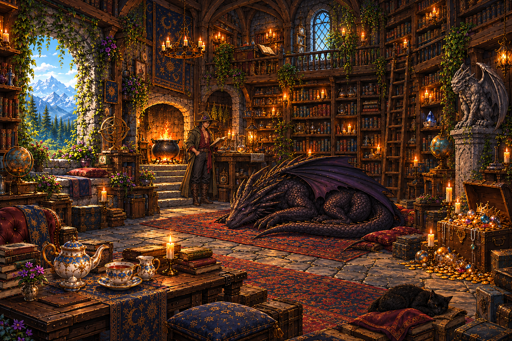

# Library atmosphere art pack

[**New composition painting**](assets/master.png) · [**Actual separate-layer assembly**](layer-assembly.png) · [**Download PNGs, JSON and preview**](../atmosphere-kit.zip?raw=true)

Ten new images move the room toward the original inspiration: a larger central sleeping dragon, a smaller wizard beside the rear workbench, a cropped worn oak tea table, subdued chair, modest footrest, irregular belongings, and distributed candle pools. The original interactive kit remains in `library-kit/`.

## New images

| File | Purpose |
| --- | --- |
| `assets/master.png` | Complete opaque art-direction painting. This is not an assembled export of the sprites. |
| `assets/architecture.png` | Empty stone, timber, shelves, hearth, stairs and pedestal; transparent exterior openings. |
| `assets/dressed_room.png` | Alternative static room plate with irregular shelf books, plants, rugs and small candle pools; interactive focal props omitted; transparent exterior openings. |
| `assets/tea_table.png` | Separate plain worn oak table with celestial textile runner. |
| `assets/chair.png` | Separate muted velvet reading chair and throw. |
| `assets/small_cushion.png` | Separate modest cushion and low footstool. |
| `assets/treasure_cluster.png` | Separate open treasure chest, two small boxes, coins, jewels and rolled textile; one rigid group. |
| `assets/shelf_cluster.png` | Separate irregular books, scroll, bottles and candle; one rigid group. |
| `assets/study_cluster.png` | Separate layered books, manuscript, ink/quill and purple flowers; one rigid group. |
| `assets/dragon.png` | New quiet curled sleeping dragon painted to match the master. |

The `retained/` folder supplies fourteen earlier sources used by the assembly: outdoor landscape, wizard, gargoyle, ladder, cauldron, astronomical instrument, fire and seven tea pieces. The saucer uses the recent deeper-rim redraw. Original sources remain separate PNGs; no Python image processing was used to repaint or extract the artwork.

## Assembly and metadata

`scene.json` records all 24 source files, native dimensions, alpha bounds, SHA-256 hashes, source-relative UV anchors, 19 placed instances, transforms, supports, depths, attachment contracts, conservative collision proxies and preview limits. Per-instance JSON is in `metadata/`. Source UVs include transparent margins. The canvas is 1536 × 1024, with x right and y down; preserve aspect ratios.

Draw the exterior behind **one** room plate, then draw the instances in ascending z. The architecture and dressed plates are alternatives, not additive layers. Their separately generated geometry is approximate, not pixel-registered interchangeable masks. The dressed plate already contains its architecture, static belongings, rugs and painted illumination; it is not a transparent furnishings-only overlay.

`layer-assembly.png` is generated by the included preview from these separate assets. It intentionally differs from the complete master painting: it demonstrates what the supplied raster layers reproduce. The cup and lid use seat constraints; the cup has a separate tight shadow on the saucer well. Contact shadows are simple preview ellipses and authored support estimates, not physical light transport.

The chest lid, coins, flowers, bottles and books inside the new clusters are not separately segmented or animated. The new preview supports layer modes and alpha-based click inspection. Previous movement, smoke and dynamic lighting controls have not been ported into this new art-direction pack. Geometry/physics values are authored estimates.

The new dressed room has painted candle/daylight shading. Outdoor openings remain transparent, but this plate is not a neutral relighting pass. A future full lighting implementation needs neutral dressing and separate illumination/occlusion layers. The older interactive kit retains its existing controls.

## Preview

Extract the ZIP, open `atmosphere-kit/preview.html`, and choose the extracted `atmosphere-kit` folder at the prompt. You can also serve that folder over local HTTP. Switch between the complete composition painting, actual layer assembly, dressed room plate and empty architecture. Click props in the layer assembly to inspect their JSON.
