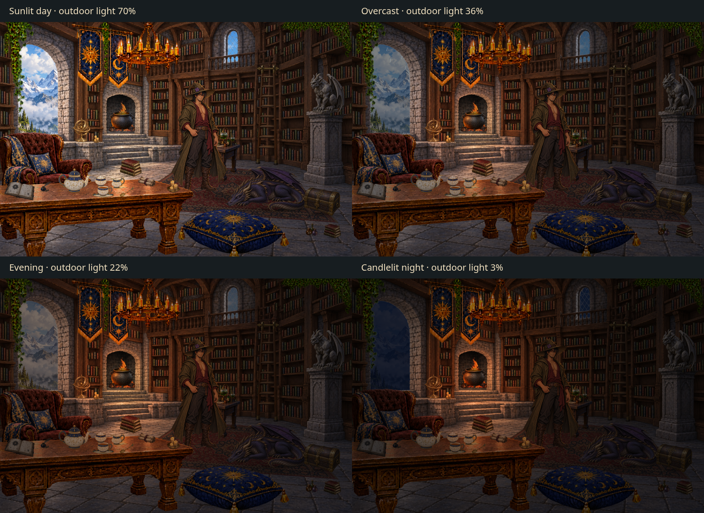

# Wizard library asset kit — revision 7: diffuse celestial tea service

[**Compare the lighting presets**](lighting-comparison.png) · [**Before / after**](lighting-before-after.png) · [**View the daylight scene**](composite.png) · [**Download the ZIP**](../library-kit.zip?raw=true) · [**Scene JSON**](scene.json)

The room now has shared interior lighting, independently adjustable outdoor light, contact shadows, projected cast shadows, shelf occlusion, and separate candle/hearth light controls. The wizard, celestial tea service and scene layout are preserved. The package includes **29 art/layer PNGs**, **48 lighting/shadow PNG snapshots**, **22 interactive object records**, **65 shelf rows**, metadata, and the interactive preview.

## Redrawn tea service

[Close-up of the complete service](tea-service-closeup.png)

All seven tea-service sprites were redrawn from the original ivory, cobalt-blue and gold celestial designs: open teapot body, removable lid, amber-filled cup, saucer, creamer, sugar bowl with cubes, and engraved spoon. The new `*_diffuse.png` drawings remove strong specular streaks, glints and reflected hot spots while retaining mild volume and crease shading. The service is grouped closer together, with sugar and creamer behind the seated cup, teapot to the left, and spoon to the right. Nearby scrolls and writing tools were moved aside.

Active asset records point to these new drawings. Tea uses only a gentle 96% brightness / 94% saturation / 98% contrast / 2% sepia material response, followed by shared room illumination and separate support shadows. Individual handles, spouts, cup/saucer and lid/teapot seat anchors remain recorded. This is diffuse 2D artwork, not a normal-map or physically based specular renderer.

The seven older glossy PNGs remain in the Git repository and the earlier teapot comparison archive. The updated main ZIP includes the 29 active art/layer files required by `scene.json`, excluding those seven superseded source files. Apply `render.material_response` in the order recorded by `lighting.material_response_contract` to reproduce the browser view.

## Loose clutter pack

Six original transparent PNGs add eight independent placements: two stacks of worn leather books, an open celestial grimoire, two brass trays of beeswax candles, a tied scroll bundle, a dark glass inkwell with feather quill, and a corked potion-bottle group. They remain separate from `furnishings.png`. [Download only the new clutter and its JSON](../clutter-pack.zip?raw=true).

`metadata/clutter-pack.json` records the source rasters and every placed instance. Each instance includes untrimmed UV anchors, an aspect-preserving transform, support, depth, alpha click picking, a conservative collision proxy, mass/material estimates, grip/contact points, interaction limits, and its separate shadow rule. Candle flame origins and warm light pools are recorded; candle intensity follows the existing control. Flames are painted into the supplied idle sprite, so extinction and independent flame animation require additional art.

The open grimoire, scrolls, and writing set can be dragged to clear spots on the tea table. Invalid drops return to the prior support. Floor groups and lit candle trays are inspect-only in this preview. Books, bottles, scrolls, and writing tools inside each sprite are rigid groups; their individual members are not segmented. No new wizard pickup pose is included.

## Light and depth controls

| Control | Behavior |
| --- | --- |
| Outdoor light, 0–100% | Changes exterior exposure and the light entering the room, including bounce/fill and the floor light patch. |
| Outdoor warmth, 2800–8500 K | Changes the daylight contribution from warm amber to cool blue. |
| Sun height, 12–75° | Low sun produces longer floor/table shadows; high sun shortens them. |
| Candlelight, 0–100% | Changes the chandelier and smaller warm light pools independently of daylight. |
| Hearth light, 0–100% | Changes fire illumination and the separate flame effects independently of daylight. |
| Shared lighting | Toggles the interior gain-map pass for comparison. |
| Contact and cast shadows | Toggles receiver shadows and ambient occlusion. |

Four presets are included: **Sunlit day, Overcast, Evening, and Candlelit night**. Manual controls produce a Custom state. Presets re-enable lighting/shadows; Reset restores the default scene and daylight preset. At zero daylight, candles and hearth can still illuminate the room. A small configurable ambient term retains readability when all added lights are zero.

Contact darkening stays on supporting surfaces. Directional shadows project original sprite silhouettes onto the floor, tabletop or ledge; low daylight switches the dominant shadow source to the hearth or chandelier. Tea shadows respond to moving/lifting objects. Hiding the wizard removes both his sprite and his shadow. Shelf corners and the rug edge receive subtle occlusion. Static grouped furniture uses explicit shadow proxies and contact points.

## Scene and character assets

- **Wizard:** new full-body idle illustration based on the original character design: crooked olive hat and purple flower, dark hair, spectacles, gold earrings, olive coat, burgundy wrap shirt and boots. He stands in front of the workbench and behind the foreground tea table. `Show wizard` toggles him independently; he is excluded from the static furnishings raster. Both feet, both hand grip points and costume details are recorded in metadata.
- **Tea service:** matching celestial ivory, cobalt-blue and gold teapot, removable lid, amber-filled cup, shallow saucer, creamer, sugar bowl and separate engraved spoon. The creamer now pours to the left from its right-side handle; attachment data was updated. Sugar cubes are grouped in the bowl artwork, rather than separately movable.
- **Hearth:** the architecture now has a dark recessed firebox and a visible stone floor slab. All three cauldron contact points are recorded on that slab, with separate contact shadows. Fire remains independently animated and clipped to the firebox.
- **Adjacent alcove:** the unexplained arched niche and little railing/counter were replaced with a conventional narrow rectangular bookcase. Its book rows were retraced.
- **Ladder:** replaced with a nearly upright full-length sprite. Both feet meet the floor; the top hooks meet a visible short brass rail. The dragon was moved forward to avoid its wing occupying the ladder's contact area. Sliding and climbing are not animated yet.
- **Vines and chair:** the ladder, gargoyle and central bench are clear of dangling vines. The chair is muted oxblood-brown instead of bright red.
- **Rug:** woven low wool pile, nap variation and short dark tan/brown fringe replace the bright white edge. It remains fitted to the floor plane with subtle textile self-shading.
- **Instrument:** redrawn with an upright stem and a shallow base ellipse, recalibrated to the raised left stone ledge.

## Preview

1. Download and unzip the kit.
2. Open **preview.html** in your browser.
3. If prompted, choose the kit's **assets** folder. This lets the preview load the images without a web server.
4. Use **Lighting preset** and the sliders in **Light and depth**.

If your browser restricts local scripts, serve this folder with `python -m http.server 8000 --bind 127.0.0.1`, then open **http://127.0.0.1:8000/preview.html**. GitHub's file viewer shows the PNGs and source but does not execute the interactive HTML.

Use **Show wizard** to compare character scale and palette. Click the dragon for smoke or the cauldron for steam. Drag tea pieces onto the tabletop, or seat the cup on its saucer and lid on the teapot. Moving a seated parent carries its child. Invalid drops return to the last support; Escape cancels a drag; Reset restores initial placement. The object menu supports keyboard activation. Layer toggles expose the blank architecture. Selecting the outside Night or Rain view also selects a matching lighting preset. The exterior uses the existing landscape with exposure/color grading and procedural rain; alternate painted weather landscapes are not included.

## Files

| File | Purpose |
| --- | --- |
| `assets/outside_day.png` | Opaque alpine exterior behind the transparent openings. |
| `assets/room.png` | Empty room architecture with transparent outdoor openings and preserved mullions. |
| `assets/furnishings.png` | Full-canvas transparent convenience overlay, rendered from the exact book/rug/table/decor placement data. Excludes interactive objects and hearth effects. |
| `assets/decor.png` | Short banners, chandelier, ivy, foreground tea table, chair and cushion, without books, floor rug or potion table. |
| `assets/book_row.png` | Flat-baseline source book strip used by 65 shelf instances. |
| `assets/rug.png` | Orthographic textile texture, projected by `floor_props` JSON. |
| `assets/potion_table.png` | Full-legged potion workbench. |
| `assets/hearth_fire.png` | Separate transparent logs/flames, with rear-fire and upper-flame crops in JSON. |
| `assets/smoke_wisp.png` | Transparent wisp used for dragon smoke and optional cauldron vapor. |
| `assets/dragon.png`, `gargoyle.png`, `ladder.png`, `cauldron.png`, `chest.png`, `astrolabe.png` | Individual interactive props. |
| `assets/teapot.png`, `teapot_lid.png`, `teacup.png`, `saucer.png`, `milk_jug.png`, `sugar_bowl.png`, `spoon.png` | Independent celestial tea pieces. |
| `assets/wizard.png` | Independent full-body idle character sprite. |
| `scene.json` | Authoritative transforms, depth, physics estimates, source crops, projective quads, anchors, contacts, click rules, weather and character-integration contracts. |
| `metadata/*.json` | Object records plus shelf/rug/table placement data. |
| `validation.json` | PNG/hash checks, attachment coincidence, table-foot support, tea-base support, book baselines, and hearth containment. |
| `preview-checks.json` | Browser checks for daylight response, independent interior lights, shadow updates, temperature, sun height, dragging, reset, transparency, smoke, blank-room isolation and folder loading. |
| `lighting.js` | Shared light-map and receiver-shadow renderer. |
| `lighting/manifest.json` | Lighting PNG dimensions, hashes, presets, receivers, blend modes and placement. |
| `lighting/*.png` | Separate contact/cast shadow maps, shelf/rug occlusion, and opaque RGB gain maps for four default-arrangement snapshots. |
| `metadata/lighting.json` | Light sources, gain fields, controls, receiver geometry and export contracts. |
| `lighting-comparison.png`, `lighting-before-after.png` | Labeled lighting comparisons. |
| `composite.png`, `composite-overcast.png`, `composite-evening.png`, `composite-night.png` | Native-resolution lighting preset snapshots. |
| `composite.png` | Native 1536 × 1024 assembled scene with wizard, without editor controls. |
| `composite-without-wizard.png` | Matching scene without the wizard, for comparison. |
| `preview.png` | Full browser workbench screenshot. |
| `smoke-preview.png` | Snapshot with the revised smoke active. |

## Assembly

Canvas: **1536 × 1024**, origin at top left, x right, y down. Scale the scene uniformly. Source-raster UV anchors include transparent margins; they do not refer to alpha-cropped bounds. Individual prop images have different native dimensions. Use the recorded dimensions and transforms.

For exact preview reproduction, use `layers` and the separate `shelf_rows`, `floor_props`, `static_props`, `effects` and `objects` collections. Draw outside at z0, architecture at z10, books at z12, floor rug at z14, rear hearth fire at z22, cauldron at z24, rim flames at z25, potion table at z32, other props at their recorded depths, the wizard at z54, foreground decor at z60, the gargoyle at z65, and tea above the foreground table at z75–80. Held props temporarily move to z100. Clip hearth effects and cauldron to `hearth_interior`.

`assets/furnishings.png` is a convenient preassembled raster alternative for the static portions. **Use it instead of the separate static collections, not in addition to them.** Keep `decor.png` separate when accurate foreground occlusion is needed. Never draw the room architecture into the outdoor layer.

Book rows use their source strip crops and individually traced shelf quads. Rug and books are rendered as clipped affine triangle meshes over their stored quads. Contact shadows are generated separately at support points rather than baked into prop backgrounds.

Alpha-based click testing uses threshold 32/255 after inverse coordinate conversion. Transparent handle holes pass clicks through. The preview also excludes hidden firebox regions and portions hidden behind foreground decor. Collision proxies are conservative approximations, not click masks.

## Interaction scope

Mass, capacity, friction, temperature, collision shapes and reach distances are authored design estimates. The browser is a lightweight interaction demonstrator, not a rigid-body simulator. Numeric precision does not imply measured physical accuracy.

Tea JSON includes grip points, seat constraints, pouring origins, tilt limits, volume estimates and a character-hand attachment contract. The wizard idle pose is included; reaching, holding, pouring and hand occlusion artwork are not. Pouring remains specified rather than implemented. The cup starts with 120 ml of amber tea represented in its raster; arbitrary draining requires separate liquid/interior layers.

The chest remains a closed combined sprite; opening requires separate body/lid/interior artwork. The armillary sphere needs separate ring layers for gimbal motion. Ladder sliding/climbing needs a calibrated rail and character poses. No dragon skeletal rig is supplied; smoke is animated independently without moving its ground contacts.

Shared gain maps now change the room and props with exterior light, but the original painted highlights remain. This is an artistic 2.5D lighting approximation without per-pixel normal/depth maps or 3D light transport. Only daylight exterior art is included. Arbitrary character walk-behind still requires additional occlusion masks. Some generated opaque pixels remain at 254/255 alpha, allowing slight backdrop bleed. This remains a new interpretation of the reference rather than a pixel-exact reconstruction.

## Character and interaction limits

The wizard is a new illustration based on the supplied design, not a pixel extraction from the original character sheet. His design height is estimated at 1.9 m for planning, not measured from the illustration. Scene scale is a 2.5D authored approximation. The idle pose provides a thematic and scale comparison; it does not yet perform pickups or walking. The metadata distinguishes the supplied idle art from required future interaction poses.

## Applying the separate lighting rasters

`scene.json` includes `lighting` configuration and `lighting_assets` records. The separate `lighting/manifest.json` lists every snapshot map with its receiver and blending contract. The snapshots assume the default object arrangement with wizard visible. Regenerate maps through the renderer when moving/hiding objects; the browser does this automatically.

1. Render the exterior with its exposure and atmosphere.
2. Render room architecture and the neutral static layers into a separate interior buffer. Draw floor shadows at z15, hearth shadows at z23.5, ledge shadows at z46.5, pedestal shadows at z64.5, and tabletop shadows at z70, respecting receiver polygons and object depth.
3. Multiply the selected **illumination-map** into the interior buffer. Restore its original alpha afterward so transparent outdoor openings remain open.
4. Composite the lit interior over the exterior. Do not multiply the exterior a second time.

Contact/cast/AO PNGs contain transparent black shading and use source-over blending. The **illumination-map** PNGs are opaque RGB gain maps; they are not scene overlays and must not be drawn source-over. The supplied neutral `assets/furnishings.png` excludes these new shadow/light passes. The renderer and JSON preserve the source art separately from its lighting.

The maps use artistic sRGB compositing, not calibrated physical illumination. The night view is a graded daylight landscape. Accurate relighting of every painted highlight, hard 3D wall/furniture shadows, and arbitrary character walk-behind need additional depth, normal or occlusion data.
