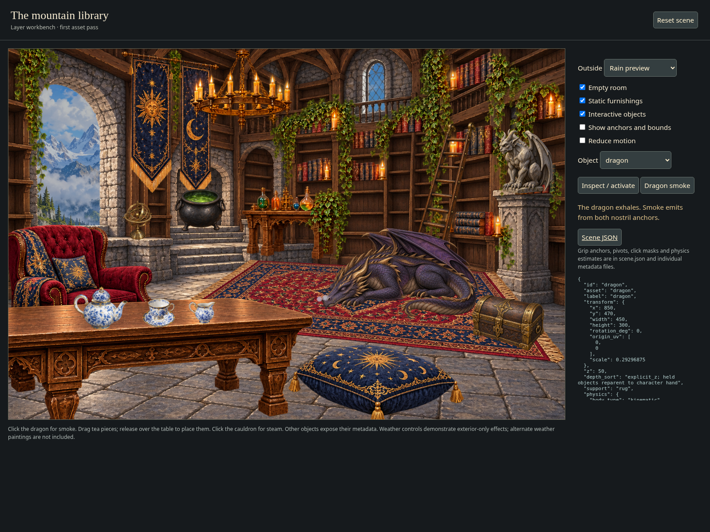
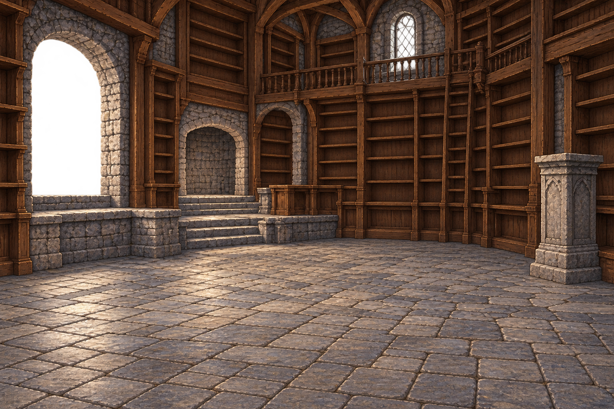
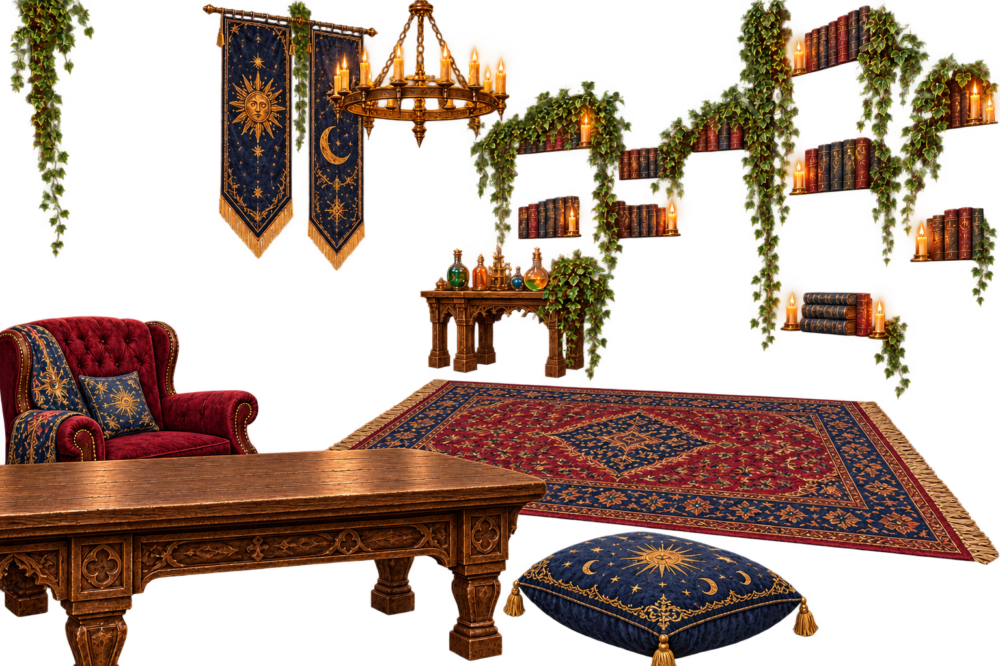

# Wizard library asset kit — first pass

14 PNG raster files, 11 independently interactive object images, detailed scene JSON, per-object JSON, and a browser preview.

[**Download the complete kit ZIP**](../library-kit.zip?raw=true) · [**Browse the PNG images**](assets/) · [**Scene JSON**](scene.json)

### Empty room

### Outdoor world

### Furnishings overlay

## Open the preview

In this folder, run `python -m http.server 8000 --bind 127.0.0.1`, then open `http://127.0.0.1:8000/preview.html` in your browser. A server avoids browsers' local-file pixel-read restrictions. No dependencies or network services are needed by the preview.

Click the dragon for procedural smoke; click the cauldron for steam. Drag tea pieces onto the tabletop. Cup and lid detach independently and can be seated again; moving a seated parent carries its child. Invalid drops return to the previous support. Escape cancels a drag. The object menu provides keyboard-accessible inspection and activation. Layer toggles reveal the empty architecture. Rain and night controls are procedural demonstrations affecting the exterior, not additional painted weather images.

## Files

- `assets/outside_day.png`: opaque full-frame alpine exterior.
- `assets/room.png`: empty room architecture; outdoor openings transparent, window mullions preserved.
- `assets/furnishings.png`: single transparent grouped furnishing overlay, excluding interactive objects.
- `assets/dragon.png`, `gargoyle.png`, `ladder.png`, `cauldron.png`, `chest.png`, `astrolabe.png`: transparent individual props.
- `assets/teapot.png`, `teapot_lid.png`, `teacup.png`, `saucer.png`, `milk_jug.png`: independently movable tea pieces.
- `scene.json`: authoritative canvas, layers, assets, transforms, interaction design, physical estimates, support surfaces, anchors, attachments, weather and character integration contracts.
- `metadata/*.json`: convenient individual object copies of the corresponding scene objects.
- `validation.json`: PNG decoding, dimensions, hashes, attachment coincidence and canvas bounds checks.
- `preview-checks.json`: browser checks.
- `preview.png`: rendered browser screenshot.

## Assembly and coordinates

Canvas: 1536 × 1024. Use a uniform contain scale; do not stretch props independently. Draw outside at z0, architecture at z10, static furnishings at z30, then props in ascending z. All full-size layers draw at (0,0). Prop transforms specify the entire source raster including transparent padding. Object widths and heights preserve original aspect ratios. JSON UV anchors use source-image coordinates, NOT cropped alpha-bounding-box coordinates. `scene_point = translation + rotation × scale × source_pixel`. Rotation is clockwise in screen coordinates, x right, y down.

Each prop keeps its own native resolution. Do not assume identical raster sizes. Use the recorded width/height and transforms. Click testing samples source alpha after inverse scene transform; threshold is 32/255, so transparent handle holes pass through. Do not use the conservative convex physics polygon as the click region.

The room's own alpha encodes outdoor cutouts. Render weather before the room so it cannot rain over indoor furniture. The room generator left opaque regions near 254/255 alpha, so minimal exterior bleed remains; a final matte pass would improve this. Do not use the screenshot as a source layer.

## Interaction and physics scope

Physical mass, capacity, friction, temperature, collision proxies, and reach distances are authored estimates. They are not measured or recovered physical properties. Precise coordinate storage does not imply subpixel calibration accuracy. Scene metadata is a design specification; the browser is a lightweight demonstrator, not a rigid-body simulator.

Tea props have grip points, supports, pouring origins, volume estimates, tilt limits and attachment rules. Lid and cup anchor coincidence is verified numerically. For character integration, split hands into palm-behind and fingers-in-front layers. A held prop must be attached at its grip point and clear the support before translating or tilting. Wizard poses are not included in this batch. Initial vessels are empty to match the artwork; filling requires a masked liquid surface. Pouring is specified but not implemented in the preview.

The dragon's smoke is procedural, emitted at two muzzle anchors. No smoke raster animation frames or dragon skeletal rig are included. Avoid scaling the entire dragon to simulate breathing because floor contacts would slide.

The gargoyle, chest and cauldron are heavy and fixed by default. The chest is deliberately a CLOSED combined sprite. Opening it requires separate body, lid and interior artwork; rotating the whole image would rotate the box, not open its lid. The armillary sphere likewise needs separate ring layers for physically correct gimbal motion. Ladder constraints are specified, but rail and foot alignment need further calibration before sliding or climbing. The preview does not fake these unavailable motions.

## Art limitations to review

This is a new first-pass interpretation, not a pixel-exact decomposition of the original reference. Generated decorative book clusters do not all line up with shelf edges. The overlay includes warm baked candle highlights, so changing the exterior does not automatically relight the room. Arbitrary character walk-behind requires additional foreground occlusion masks; the single furnishings overlay intentionally groups decor. Contact shadows are specified for runtime but not separately supplied as raster files. Only daylight exterior artwork is supplied; night tint and rain are preview effects. A final alignment/matte pass and additional articulated art are still needed for a production scene.

