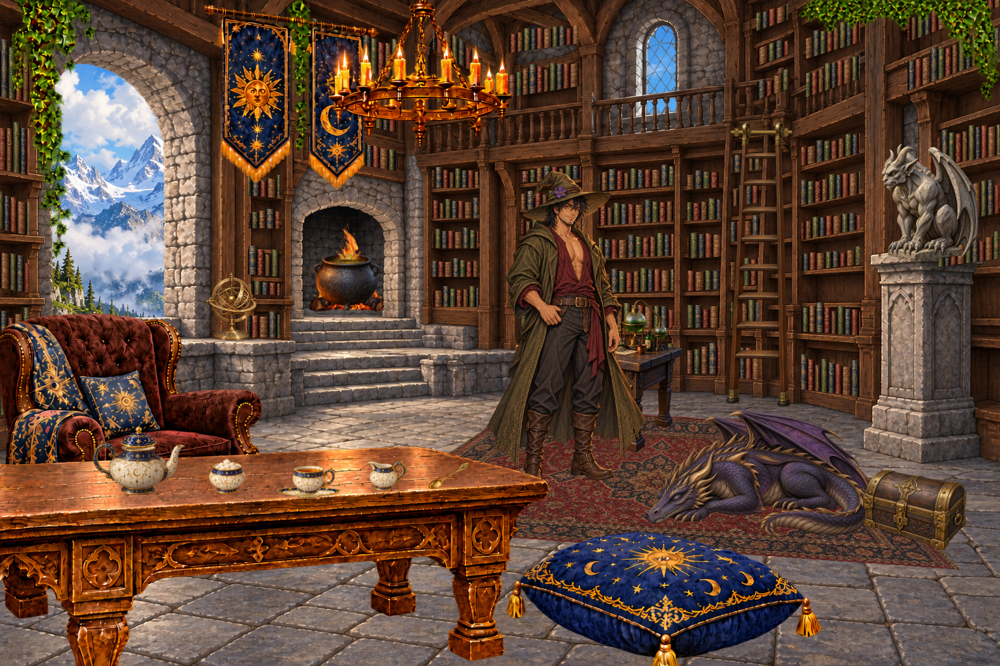

# Wizard library asset kit — revision 3

[**View the scene with the wizard**](composite.png) · [**Compare without him**](composite-without-wizard.png) · [**Download the ZIP**](../library-kit.zip?raw=true) · [**Wizard sprite**](assets/wizard.png) · [**Scene JSON**](scene.json)



This revision adds the wizard as a separate idle sprite for scale and theme review, rebuilds the blue/ivory/gold celestial tea service from the supplied inspiration, and revises the hearth, adjacent bookcase, ladder, vines, chair palette, rug and instrument angle. The package contains **23 source/layer PNGs**, **14 interactive object records**, **65 shelf rows**, metadata and a browser preview.

## Revision 3 changes

- **Wizard:** new full-body idle illustration based on the original character design: crooked olive hat and purple flower, dark hair, spectacles, gold earrings, olive coat, burgundy wrap shirt and boots. He stands in front of the workbench and behind the foreground tea table. `Show wizard` toggles him independently; he is excluded from the static furnishings raster. Both feet, both hand grip points and costume details are recorded in metadata.
- **Tea service:** matching celestial ivory, cobalt-blue and gold teapot, removable lid, amber-filled cup, shallow saucer, creamer, sugar bowl and separate engraved spoon. The creamer now pours to the left from its right-side handle; attachment data was updated. Sugar cubes are grouped in the bowl artwork, rather than separately movable.
- **Hearth:** the architecture now has a dark recessed firebox and a visible stone floor slab. All three cauldron contact points are recorded on that slab, with separate contact shadows. Fire remains independently animated and clipped to the firebox.
- **Adjacent alcove:** the unexplained arched niche and little railing/counter were replaced with a conventional narrow rectangular bookcase. Its book rows were retraced.
- **Ladder:** replaced with a nearly upright full-length sprite. Both feet meet the floor; the top hooks meet a visible short brass rail. The dragon was moved forward to avoid its wing occupying the ladder's contact area. Sliding and climbing are not animated yet.
- **Vines and chair:** the ladder, gargoyle and central bench are clear of dangling vines. The chair is muted oxblood-brown instead of bright red.
- **Rug:** woven low wool pile, nap variation and short dark tan/brown fringe replace the bright white edge. It remains fitted to the floor plane with subtle textile self-shading.
- **Instrument:** redrawn with an upright stem and a shallow base ellipse, recalibrated to the raised left stone ledge.

## Preview

From this folder, run:

```sh
python -m http.server 8000 --bind 127.0.0.1
```

Then open **http://127.0.0.1:8000/preview.html**. GitHub's file viewer does not run the interactive HTML; download the ZIP and run it locally.

Use **Show wizard** to compare character scale and palette. Click the dragon for smoke or the cauldron for steam. Drag tea pieces onto the tabletop, or seat the cup on its saucer and lid on the teapot. Moving a seated parent carries its child. Invalid drops return to the last support; Escape cancels a drag; Reset restores initial placement. The object menu supports keyboard activation. Layer toggles expose the blank architecture. Rain and night controls are exterior-only demonstrations, not alternate painted weather backgrounds.

## Files

| File | Purpose |
| --- | --- |
| `assets/outside_day.png` | Opaque alpine exterior behind the transparent openings. |
| `assets/room.png` | Empty room architecture with transparent outdoor openings and preserved mullions. |
| `assets/furnishings.png` | Full-canvas transparent convenience overlay, rendered from the exact book/rug/table/decor placement data. Excludes interactive objects and hearth effects. |
| `assets/decor.png` | Short banners, chandelier, ivy, foreground tea table, chair and cushion, without books, floor rug or potion table. |
| `assets/book_row.png` | Flat-baseline source book strip used by 65 shelf instances. |
| `assets/rug.png` | Orthographic textile texture, projected by `floor_props` JSON. |
| `assets/potion_table.png` | Full-legged potion workbench. |
| `assets/hearth_fire.png` | Separate transparent logs/flames, with rear-fire and upper-flame crops in JSON. |
| `assets/smoke_wisp.png` | Transparent wisp used for dragon smoke and optional cauldron vapor. |
| `assets/dragon.png`, `gargoyle.png`, `ladder.png`, `cauldron.png`, `chest.png`, `astrolabe.png` | Individual interactive props. |
| `assets/teapot.png`, `teapot_lid.png`, `teacup.png`, `saucer.png`, `milk_jug.png`, `sugar_bowl.png`, `spoon.png` | Independent celestial tea pieces. |
| `assets/wizard.png` | Independent full-body idle character sprite. |
| `scene.json` | Authoritative transforms, depth, physics estimates, source crops, projective quads, anchors, contacts, click rules, weather and character-integration contracts. |
| `metadata/*.json` | Object records plus shelf/rug/table placement data. |
| `validation.json` | PNG/hash checks, attachment coincidence, table-foot support, tea-base support, book baselines, and hearth containment. |
| `preview-checks.json` | Browser checks for dragging, reset, smoke cooldown, muzzle origins and blank-room isolation. |
| `composite.png` | Native 1536 × 1024 assembled scene with wizard, without editor controls. |
| `composite-without-wizard.png` | Matching scene without the wizard, for comparison. |
| `preview.png` | Full browser workbench screenshot. |
| `smoke-preview.png` | Snapshot with the revised smoke active. |

## Assembly

Canvas: **1536 × 1024**, origin at top left, x right, y down. Scale the scene uniformly. Source-raster UV anchors include transparent margins; they do not refer to alpha-cropped bounds. Individual prop images have different native dimensions. Use the recorded dimensions and transforms.

For exact preview reproduction, use `layers` and the separate `shelf_rows`, `floor_props`, `static_props`, `effects` and `objects` collections. Draw outside at z0, architecture at z10, books at z12, floor rug at z14, rear hearth fire at z22, cauldron at z24, rim flames at z25, potion table at z32, other props at their recorded depths, the wizard at z54, foreground decor at z60, the gargoyle at z65, and tea above the foreground table at z75–80. Held props temporarily move to z100. Clip hearth effects and cauldron to `hearth_interior`.

`assets/furnishings.png` is a convenient preassembled raster alternative for the static portions. **Use it instead of the separate static collections, not in addition to them.** Keep `decor.png` separate when accurate foreground occlusion is needed. Never draw the room architecture into the outdoor layer.

Book rows use their source strip crops and individually traced shelf quads. Rug and books are rendered as clipped affine triangle meshes over their stored quads. Contact shadows are generated separately at support points rather than baked into prop backgrounds.

Alpha-based click testing uses threshold 32/255 after inverse coordinate conversion. Transparent handle holes pass clicks through. The preview also excludes hidden firebox regions and portions hidden behind foreground decor. Collision proxies are conservative approximations, not click masks.

## Interaction scope

Mass, capacity, friction, temperature, collision shapes and reach distances are authored design estimates. The browser is a lightweight interaction demonstrator, not a rigid-body simulator. Numeric precision does not imply measured physical accuracy.

Tea JSON includes grip points, seat constraints, pouring origins, tilt limits, volume estimates and a character-hand attachment contract. The wizard idle pose is included; reaching, holding, pouring and hand occlusion artwork are not. Pouring remains specified rather than implemented. The cup starts with 120 ml of amber tea represented in its raster; arbitrary draining requires separate liquid/interior layers.

The chest remains a closed combined sprite; opening requires separate body/lid/interior artwork. The armillary sphere needs separate ring layers for gimbal motion. Ladder sliding/climbing needs a calibrated rail and character poses. No dragon skeletal rig is supplied; smoke is animated independently without moving its ground contacts.

Warm highlights are baked into some props, so changing the exterior does not fully relight the room. Only daylight exterior art is included. Arbitrary character walk-behind still requires additional occlusion masks. Some generated opaque pixels remain at 254/255 alpha, allowing slight backdrop bleed. This remains a new interpretation of the reference rather than a pixel-exact reconstruction.

## Character and interaction limits

The wizard is a new illustration based on the supplied design, not a pixel extraction from the original character sheet. His design height is estimated at 1.9 m for planning, not measured from the illustration. Scene scale is a 2.5D authored approximation. The idle pose provides a thematic and scale comparison; it does not yet perform pickups or walking. The metadata distinguishes the supplied idle art from required future interaction poses.
