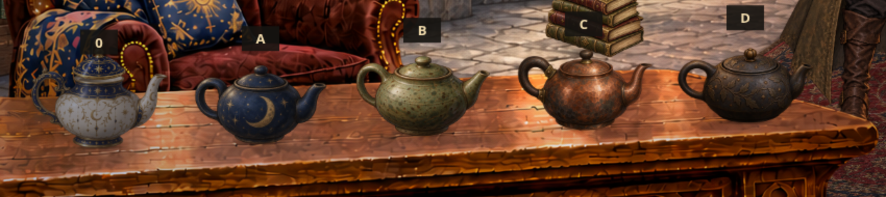

# Teapot choices

Four new transparent teapots alongside the current design, all placed on the main table with separate receiver shadows and shared room lighting.

[Full room](comparison.png) · [Candlelit comparison](comparison-night.png) · [PNG + JSON + preview download](../teapot-options.zip?raw=true) · [Scene JSON](scene.json)

| Label | Design |
| --- | --- |
| 0 | Current ivory, blue and gold |
| A | Worn celestial blue ceramic |
| B | Moss-green speckled stoneware |
| C | Hammered copper with wooden handle |
| D | Dark cast iron with leaves and stars |

The comparison temporarily clears other loose objects from the tabletop. The original room is preserved in `library-kit/`. Each new teapot is one complete closed sprite; separate removable lids can follow once a design is selected. UV anchors, contacts, grips, spout origins, conservative collision proxies, mass estimates, shadow rules and material response are in JSON.

To use the interactive preview, extract `teapot-options.zip`, run a local HTTP server in the extracted root, and open `teapot-options/preview.html`. Alternatively open the HTML directly and choose the extracted root folder when prompted; it contains both the shared `library-kit/assets` and new `teapot-options/assets` files. Lighting presets, alpha picking and tabletop dragging work as in the main preview. The ZIP includes the shared source assets needed by this comparison, not the main kit's lighting snapshot collection.
